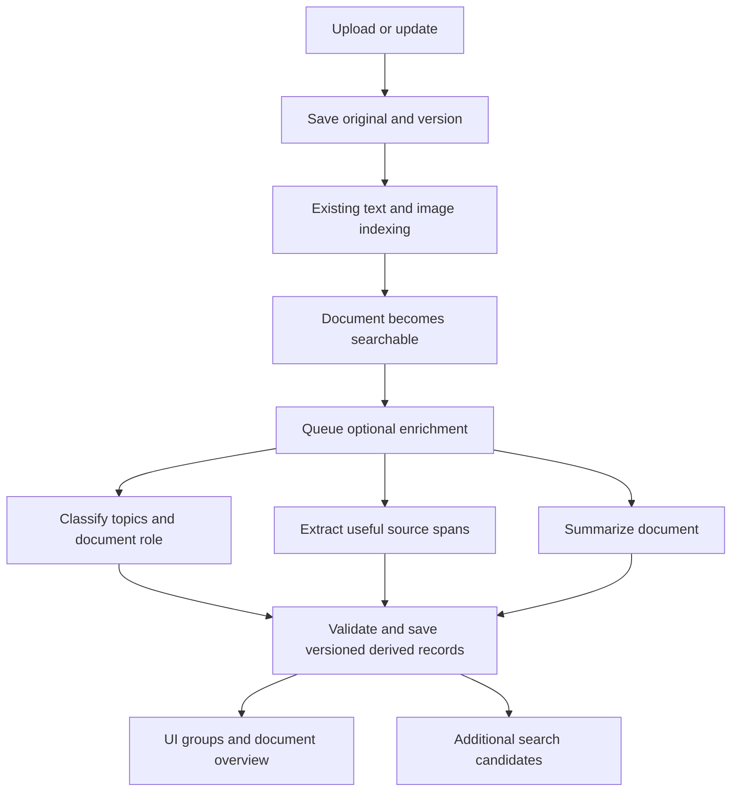
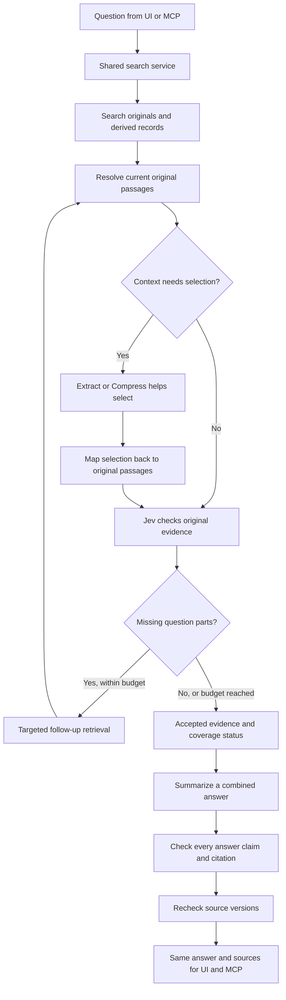

# CDM integration in Symbiknow

**Status: proposed design, not an implemented feature.**

**Research date: 18 October 2026. Updated: 19 October 2026 for the five-tool MCP API.**

This guide explains how to add ScaleDown's four actions to the current Symbiknow application. It includes real API request shapes, proposed application changes, examples, failure handling, and a test plan. The example documents are synthetic. No ScaleDown inference requests were made for this guide, and no improvement in accuracy, speed, cost, or RAM has been measured yet.

The goal is simple: **help people find answers, show where those answers came from, and make the library easier to understand.**

## Contents

1. [The four jobs](#1-the-four-jobs)
2. [What exists today](#2-what-exists-today)
3. [When a document is added](#3-when-a-document-is-added)
4. [When a user searches](#4-when-a-user-searches)
5. [Shared API setup](#5-shared-api-setup)
6. [Summarize: document overview and combined answer](#6-summarize-document-overview-and-combined-answer)
7. [Compress: reduce question context](#7-compress-reduce-question-context)
8. [Extract: find useful facts and their positions](#8-extract-find-useful-facts-and-their-positions)
9. [Classify: topics, groups, and document links](#9-classify-topics-groups-and-document-links)
10. [How Jev fits](#10-how-jev-fits)
11. [Saved data and source tracking](#11-saved-data-and-source-tracking)
12. [One search flow for UI and MCP](#12-one-search-flow-for-ui-and-mcp)
13. [Changes by file](#13-changes-by-file)
14. [Speed, memory, calls, and cost](#14-speed-memory-calls-and-cost)
15. [Failures and recovery](#15-failures-and-recovery)
16. [Complete examples](#16-complete-examples)
17. [Tests and the 95% target](#17-tests-and-the-95-target)
18. [Implementation order](#18-implementation-order)
19. [References](#19-references)

## 1. The four jobs

These are the uses we want in Symbiknow:

| Action | Simple meaning | Where it helps | What the user sees |
| --- | --- | --- | --- |
| **Summarize** | Write a short explanation of supplied text | After Jev accepts search evidence; also for an individual document | One answer across useful files, or a short document overview |
| **Compress** | Shorten context around a question | When search finds more text than the checking step can handle | Less irrelevant material in the answer process |
| **Extract** | Find requested facts and their source positions | During document enrichment and question-specific search | Exact names, dates, rules, values, and highlighted evidence |
| **Classify** | Score text against labels we define | When documents arrive; optionally when comparing candidate document pairs | Useful groups, topic labels, and meaningful links |

In this guide, “CDM integration” means the ScaleDown action suite discussed in the earlier research. These actions have different API contracts. Summarize produces rewritten text; extraction and classification have different structured outputs. We should not treat every action as a general chat model. [Provider introduction](https://docs.scaledown.ai/introduction), [Summarize overview](https://docs.scaledown.ai/api-reference/summarize-overview).

**The original document stays the evidence.** A summary, a label, or a compressed paragraph helps us work with that evidence. It does not become a new original source.

The useful product change is bigger than adding four API buttons. We save useful document information once, search it alongside the original text, find missing evidence when needed, and produce a readable answer with checked sources.

## 2. What exists today

The current repository already has important pieces to keep:

| Existing piece | Current location | How the proposal uses it |
| --- | --- | --- |
| Shared search orchestration | `app/server.py`, `search_full()` | All new search stages run here or through services it calls |
| Keyword, semantic, and hybrid retrieval | `app/search.py`, `find_documents()` | Remains the first way to find original documents |
| Jev evaluation | `app/jev.py`, `judge_matches()` | Checks whether original evidence answers the question |
| Evidence budgets and proof cache | `app/jev_proof.py` | Receives a smaller, validated set of original passages |
| Question and citation decisions | `app/jev_decisions.py` | Extend with explicit generated-answer checks |
| Numeric answers | `app/jev_numeric.py` | Keep exact local calculation and verified inputs |
| Current-version publication checks | `app/server.py`, `_refresh_matches()` | Recheck sources before publishing answers |
| Original storage and ingestion | `app/ingest.py`, `index_document()` | Enqueue enrichment after successful indexing |
| Topic decisions and saved organization | `app/jev_topics.py`; `app/search.py`, `save_organization()` | One configured owner publishes automatic metadata |
| Shared UI/MCP result projection | `app/search_projection.py`; `frontend/src/api.ts` | Add results without creating a second search implementation |

Today, evaluated search limits the candidate document count to eight. The proof code also limits evidence to 12 passages per document, 16,000 text characters per document, and 50,000 total text characters. These are application guards, not a statement of a provider's maximum context.

The latest saved 16-question diagnostic run had:

- 11 expected outcomes out of 16 searches.
- Four searches blocked by application context limits before reaching Jev.
- One missed correction to a false assumption, although useful evidence was retrieved.

This gives us concrete problems to improve. Simply changing the provider will not fix the application's early context rejection. See the [full baseline report](outputs/jev-hard-questions-2026-10-18/REPORT.md).

## 3. When a document is added



“Derived records” means information we created from the original: a topic, an extracted fact, or a summary.

### Proposed sequence

1. Keep the existing original-file commit and indexing behavior.
2. Add an enrichment job containing the document ID, exact version, and text hash.
3. Read bounded text windows from that version. Preserve page, section, and chunk identity.
4. Classify useful topics. Extract facts using a schema suitable for that document type.
5. Create a document summary in the background or when first requested.
6. Validate response shapes and source positions.
7. Confirm that this version is still current before publishing current-library metadata.
8. Save the result and mark enrichment complete, partial, or failed.

Upload success must not depend on ScaleDown being available. A saved file can be searchable while enrichment is still pending. Network calls must happen outside the index lock.

### Long documents

Do not silently take the first page and call it a complete document summary. Track which sections were processed. For large documents, process bounded sections, retain their source references, and optionally build a higher-level overview. A summary built from section summaries still needs original-source checks if we present it as checked.

If only some sections were processed, the UI should say **“Summary of processed sections.”** Whole-document coverage is a separate property from whether each written sentence is supported.

### Keep user choices

Automatic labels must not overwrite a manual folder or group correction. Also, Jev and CDM must not independently race to write the same organization fields. Choose one configured writer per action. A second model can run in evaluation mode and record a comparison without publishing changes.

## 4. When a user searches



The loop has a fixed limit. It is not an agent that searches forever.

### Search in two places

Search both original chunks and useful saved records. For example, a saved fact about “five public MCP tools” can help find the right document even when the user's wording is “what tools have in symbiknow?”

Merge and deduplicate these candidates by original document and version. Apply the same folder/group scope and current-version rules to both. Resolve every candidate back to original text before proof. A generated summary can suggest a source; it cannot prove its own claims.

Start by comparing original-only retrieval with combined retrieval. Do not add embeddings for every label and fact automatically: first test whether a small text index and existing embeddings are enough.

### Track each part of a question

For “Which tools exist, and what happens if an upload response is lost?”, track the tool list and upload recovery separately. A source answering only the first part must not produce a complete-answer status.

Question splitting is an additional capability to implement and test. Extract is not automatically a general question planner. Start with explicit conjunctions and existing coverage decisions; if a model-based planner is later added, verify that it preserves every part of the original question.

For a missing part, allow a targeted retrieval pass using that part's wording, known aliases, and the original scope. Return a partial answer when evidence remains missing. Say **“I could not find this in the checked sources”**, rather than claiming the fact cannot exist anywhere.

### Preserve exceptions

Useful context includes more than the matching sentence. Bring back headings, entity names, dates, negation, exceptions, and relevant cross-document rules. When a window cannot fit, mark the limitation. Never shrink context by simply cutting off the last characters of a passage.

## 5. Shared API setup

The documented API host is `https://api.scaledown.xyz`. The examples use the `x-api-key` header. Keep credentials on the Python server, not in React, browser storage, source files, or logs. [Provider setup](https://docs.scaledown.ai/introduction).

| Action | Method and path | Model field | Result to read |
| --- | --- | --- | --- |
| Summarize | `POST /v1/chat/completions` | `summarize-1` | Parse message content JSON, then `summary` |
| Extract | `POST /v1/chat/completions` | `extract-1` | Parse message content JSON, then `entities` |
| Compress | `POST /compress/raw/` | Not used in these examples | `results.compressed_prompt` after success checks |
| Classify topics or links | `POST /classify` | Not assumed | `scores`, plus `top_label` for single-label work |
| Optional typed decision comparison | `POST /v1/scaledown` | `classify-1` | Typed `answers`; validate each requested key |

Each action's official contract is linked in its section below.

### Proposed configuration

These variables are a proposal; the current application does not gain support merely by adding them to `.env`.

```dotenv
SCALEDOWN_API_KEY=replace_in_local_server_environment
CDM_ENABLED=false
CDM_DOCUMENT_SUMMARIES=false
CDM_SEARCH_SUMMARIES=false
CDM_EXTRACT=false
CDM_COMPRESS=false
CDM_CLASSIFY=false
CDM_MAX_CONCURRENT_CALLS=2
CDM_SEARCH_MAX_CALLS=6
CDM_SEARCH_DEADLINE_SECONDS=30
```

The numeric settings are initial experiment limits, not measured optimal defaults. A six-call limit cannot process every document through every action. The scheduler must reuse saved work, skip optional stages, or return a limited result when the budget is exhausted.

### A small Python client for the examples

The Python blocks below can be combined in order. They define functions; importing them does not send a request. Calling an action function will send its supplied text to ScaleDown and may incur provider charges.

This client uses the standard library, so the examples need no extra SDK. It illustrates bounded payloads and response reading. Production code still needs cancellation, a shared concurrency limit, a total search deadline, metrics, and action-specific validation.

```python
import json
import math
import os
import urllib.error
import urllib.request

BASE_URL = "https://api.scaledown.xyz"
MAX_REQUEST_BYTES = 512 * 1024  # Example application limit, not provider limit.
MAX_RESPONSE_BYTES = 1024 * 1024


class CDMError(RuntimeError):
    pass


class NoRedirect(urllib.request.HTTPRedirectHandler):
    def redirect_request(self, req, fp, code, msg, headers, newurl):
        return None  # Do not forward the API key to a redirected destination.


def post_json(path, payload):
    allowed = {"/v1/chat/completions", "/compress/raw/", "/classify", "/v1/scaledown"}
    if path not in allowed:
        raise CDMError("Unsupported action endpoint")
    key = os.environ.get("SCALEDOWN_API_KEY")
    if not key:
        raise CDMError("ScaleDown is not configured")
    data = json.dumps(payload, ensure_ascii=False, allow_nan=False).encode("utf-8")
    if len(data) > MAX_REQUEST_BYTES:
        raise CDMError("Request exceeds application byte budget")
    request = urllib.request.Request(
        BASE_URL + path,
        data=data,
        headers={"Content-Type": "application/json", "x-api-key": key},
        method="POST",
    )
    try:
        opener = urllib.request.build_opener(NoRedirect())
        with opener.open(request, timeout=20) as response:
            raw = response.read(MAX_RESPONSE_BYTES + 1)
    except urllib.error.HTTPError as exc:
        # Do not log error bodies: they may contain submitted document text.
        raise CDMError(f"Provider HTTP status {exc.code}") from None
    except (urllib.error.URLError, TimeoutError, OSError):
        raise CDMError("Provider connection failed or timed out") from None
    if len(raw) > MAX_RESPONSE_BYTES:
        raise CDMError("Response exceeds application byte budget")
    try:
        result = json.loads(raw)
    except (ValueError, UnicodeError):
        raise CDMError("Provider returned invalid JSON") from None
    if not isinstance(result, dict):
        raise CDMError("Expected a JSON object")
    return result


def chat_result(response):
    # Summarize and Extract place a second JSON object inside message.content.
    try:
        content = response["choices"][0]["message"]["content"]
        parsed = json.loads(content)
    except (KeyError, IndexError, TypeError, ValueError):
        raise CDMError("Invalid action response") from None
    if not isinstance(parsed, dict):
        raise CDMError("Expected action result object")
    return parsed


SAMPLE_TEXT = (
    "Symbiknow exposes five MCP tools: upload, download, search, upload_folder and download_folder. "
    "Upload stores files. Download retrieves originals. "
    "Search finds relevant evidence. "
    "Upload_folder stores files with their relative subfolders. "
    "Download_folder exports a library folder and descendants as a ZIP. "
    "Hiding rebuild progress does not cancel the worker."
)
SAMPLE_QUESTION = "Which MCP tools exist, and does hiding progress stop a rebuild?"
```

## 6. Summarize: document overview and combined answer

Use `POST /v1/chat/completions` with `summarize-1`. The response's `message.content` contains JSON, including `summary` and an inner `finish_reason`. The documented output limit is 1,000 tokens; streaming is not supported. Treat `finish_reason: length` as incomplete. [Summarize API](https://docs.scaledown.ai/api-reference/summarize).

### A. Summary of one document

```python
def summarize_document(text):
    response = post_json("/v1/chat/completions", {
        "model": "summarize-1",
        "max_tokens": 240,
        "messages": [
            {"role": "system", "content": (
                "Write a short document overview in simple English. "
                "Explain its purpose, main facts, and important limits. "
                "Preserve negation and exceptions."
            )},
            {"role": "user", "content": text},
        ],
    })
    result = chat_result(response)
    if result.get("finish_reason") != "stop":
        raise CDMError("Summary did not finish normally")
    summary = result.get("summary")
    if not isinstance(summary, str) or not summary.strip():
        raise CDMError("Missing summary")
    return {"text": summary, "usage": response.get("usage", {})}


# Live example, deliberately not invoked in this guide:
# overview = summarize_document(SAMPLE_TEXT)
```

Store the overview with its document version, processed-section coverage, prompt version, and verification status. Show it in the document reader and optionally on an expanded card. Avoid generating it again whenever a card renders.

A document overview can be labeled **“AI summary”** before claim verification. Give it a checked badge only after checking the actual summary claims against originals. This matters because rewriting can change meaning even when the original source was valid.

### B. One answer from the sources accepted by Jev

“All checked files” should mean the relevant evidence Jev accepted for this question, including required qualifications and corrections. Do not send every paragraph of every retrieved file merely because one paragraph passed.

The application creates short source aliases such as `S1`. It stores a server-side mapping from each alias to exact original document/version/chunk/offset references. The model must not invent or select authoritative storage IDs.

```python
def summarize_answer(question, accepted_sources, coverage):
    # accepted_sources is built by the server AFTER original-evidence checks.
    # Example item: {"source_id": "S1", "text": "exact original passage"}
    source_packet = {
        "question": question,
        "coverage": coverage,
        "accepted_sources": accepted_sources,
    }
    response = post_json("/v1/chat/completions", {
        "model": "summarize-1",
        "max_tokens": 500,
        "messages": [
            {"role": "system", "content": (
                "Write a short answer to the supplied question using only the "
                "accepted sources. Put one factual claim in each bullet and "
                "attach supplied source tags such as [S1]. Preserve exceptions, "
                "dates, and corrections. Clearly state unanswered parts."
            )},
            {"role": "user", "content": json.dumps(source_packet, ensure_ascii=False)},
        ],
    })
    result = chat_result(response)
    if result.get("finish_reason") != "stop":
        raise CDMError("Answer summary is incomplete")
    text = result.get("summary")
    if not isinstance(text, str) or not text.strip():
        raise CDMError("Missing answer summary")
    # This is a draft. The caller must verify claims and resolve source tags.
    return {"draft": text, "usage": response.get("usage", {})}
```

Illustrative desired answer, **not a real model result**:

> Symbiknow has five MCP tools: upload, download, search, upload_folder, and download_folder. [S1]
>
> Hiding rebuild progress does not stop the worker. [S2]

Source tags in generated text are only suggestions until validated. Check every sentence, including text outside the requested bullets. Reject unknown tags. Ask Jev whether each claim follows from its mapped original passages, including any exceptions. Recheck source versions before publication. If the draft fails, show the accepted original evidence without a checked generated answer.

## 7. Compress: reduce question context

Use `POST /compress/raw/`, sending the question separately as `prompt` and the text as `context`. A numeric `rate` describes the approximate fraction removed; `auto` lets the provider choose. Read the nested `results` object and check success. [Compress API](https://docs.scaledown.ai/api-reference/compress).

```python
def compress_context(question, text):
    response = post_json("/compress/raw/", {
        "prompt": question,
        "context": text,
        "scaledown": {"rate": "auto"},
    })
    result = response.get("results")
    if response.get("successful") is not True or not isinstance(result, dict):
        raise CDMError("Compression failed")
    if response.get("partially_successful") is True or result.get("success") is not True:
        raise CDMError("Compression was incomplete")
    compressed = result.get("compressed_prompt")
    if not isinstance(compressed, str) or not compressed.strip():
        raise CDMError("Missing compressed context")
    return {"question": question, "candidate_context": compressed}


# candidate = compress_context(SAMPLE_QUESTION, SAMPLE_TEXT)
```

### What happens after this call?

Compression does not provide the original-source mapping this application needs. Use the result to select useful original passages, then send those original passages to Jev. The mapping step is real implementation work, not something the endpoint completes for us.

For an initial experiment, compress one document window at a time and retain its identity outside the model. Match exact surviving text to that original window. Expand matches to whole original paragraphs and relevant neighboring rules. If a match is rewritten or ambiguous, use extraction or another retrieval pass instead of assigning an old citation ID to new text.

Example: compressing “Hiding progress does **not** cancel the worker” must never turn it into evidence that hiding progress cancels the worker. Test this explicitly.

The provider overview and field description treat `compressed_prompt` as shortened context, while an older note describes replacing both context and prompt. Preserve our original question separately and test the live response contract before rollout. [Compress overview](https://docs.scaledown.ai/api-reference/compress-overview).

Compression is optional. Skip it when original evidence already fits. Measure whether it saves enough downstream work to justify the extra call. We cannot assume that fewer characters means a faster or more accurate complete search.

## 8. Extract: find useful facts and their positions

Use `extract-1` on the chat-completions endpoint. Describe desired fields in `response_format.json_schema`. Scalar matches return `text`, `type`, `confidence`, `start`, and `end`; nested output uses `structured_result`. The scalar limit is 30 matches per type, so an extraction result is not proof that every matching fact was returned. [Extract API](https://docs.scaledown.ai/api-reference/extract).

### Request example

```python
def extract_candidates(text):
    properties = {
        "tool_name": {
            "type": "string",
            "description": "Names explicitly identified as public Symbiknow MCP tools",
        },
        "cancellation_rule": {
            "type": "string",
            "description": (
                "Original clauses stating whether hiding progress stops or cancels "
                "a rebuild worker, including any negation"
            ),
        },
    }
    response = post_json("/v1/chat/completions", {
        "model": "extract-1",
        "messages": [
            {"role": "system", "content": "Extract exact source text matching the described fields."},
            {"role": "user", "content": text},
        ],
        "response_format": {
            "type": "json_schema",
            "json_schema": {
                "name": "symbiknow_evidence",
                "schema": {"type": "object", "properties": properties},
            },
        },
        "context_chars": 250,
    })
    result = chat_result(response)
    entities = result.get("entities")
    if not isinstance(entities, list):
        raise CDMError("Missing extracted entities")
    return [validate_entity(text, item, set(properties)) for item in entities]


def validate_entity(text, item, allowed_types):
    if not isinstance(item, dict):
        raise CDMError("Invalid entity")
    start, end = item.get("start"), item.get("end")
    if type(start) is not int or type(end) is not int:
        raise CDMError("Invalid entity offsets")
    if not 0 <= start < end <= len(text):
        raise CDMError("Entity offsets outside input")
    if text[start:end] != item.get("text"):
        raise CDMError("Entity does not match original input slice")
    kind, confidence = item.get("type"), item.get("confidence")
    if not isinstance(kind, str) or kind not in allowed_types:
        raise CDMError("Unexpected entity type")
    if type(confidence) not in (int, float):
        raise CDMError("Invalid entity confidence")
    if not math.isfinite(confidence) or not 0 <= confidence <= 1:
        raise CDMError("Invalid entity confidence")
    return {"text": text[start:end], "type": kind, "confidence": confidence,
            "start": start, "end": end}


# entities = extract_candidates(SAMPLE_TEXT)
```

Illustrative parsed response item for `SAMPLE_TEXT`, with a **made-up confidence for demonstration**:

```json
{
  "text": "upload",
  "type": "tool_name",
  "confidence": 0.94,
  "start": 34,
  "end": 40
}
```

### Turn a match into usable evidence

1. Validate the exact input slice.
2. Attach the original document ID, version, chunk ID, and window position from our request envelope.
3. Convert window-local positions into original chunk positions.
4. Expand to the original sentence or paragraph containing the fact.
5. Add any required rule, exception, date, and subject identity.
6. Ask Jev whether those original passages support the requested answer.

If the input window starts at character 1,200 within a stored chunk, an entity at `[34, 40)` maps to chunk positions `[1234, 1240)`. This only works when the sent text is that exact original slice. Added headers, whitespace normalization, or concatenated windows require an explicit position map.

The validation example assumes Python character positions and an exclusive end. Confirm those conventions with source-position contract tests. Do not silently repair mismatches by picking the first identical phrase elsewhere in the document.

### Use different schemas for different work

| Document/question | Useful fields |
| --- | --- |
| Product documentation | Public tools, options, constraints, exceptions |
| Invoice | Supplier, amount, currency, invoice date, invoice identifier |
| Performance report | Metric, value, unit, hardware, measured date, limitations |
| Policy | Subject, rule, effective date, exception, approval state |
| Search about a specific failure | Error text, trigger, recovery action, required conditions |

Extraction finds candidates. A real number from the wrong customer, month, or draft is still the wrong answer. Preserve the numeric module's verified inputs and exact local arithmetic.

Nested objects and categorical extraction fields need separate validation; do not assume they have the same literal-span behavior as scalar entities. [Extract overview](https://docs.scaledown.ai/api-reference/extract-overview).

### Use existing document text

The CDM actions in this plan consume text already available in Symbiknow. Preserve the original document, version, chunk, and text positions for citations. Adding file conversion or text recognition is outside this integration's scope.

## 9. Classify: topics, groups, and document links

`POST /classify` accepts labels with rubrics. Multi-label mode allows several topics to fit independently. Single-label mode selects a winner, so include an `Other` or `Uncertain` option where appropriate. The documented limits are 20 labels normally, 16 for multi-label, and 50 chunks in a batch. [Classify API](https://docs.scaledown.ai/api-reference/classify).

### Topic classification when a document arrives

```python
TOPIC_LABELS = [
    {"name": "Storage", "rubric": "Does this text explain storing files, versions, or recovery?"},
    {"name": "Search", "rubric": "Does this text explain retrieval, ranking, or finding evidence?"},
    {"name": "Security", "rubric": "Does this text explain permissions or protecting data?"},
    {"name": "Research", "rubric": "Does this text report an investigation or measured experiment?"},
]


def classify_topics(text):
    response = post_json("/classify", {
        "text": text,
        "labels": TOPIC_LABELS,
        "multi_label": True,
        "threshold": 0.0,  # Collect scores for calibration; do not auto-publish all labels.
        "reasoning": False,
    })
    scores = response.get("scores")
    expected = {item["name"] for item in TOPIC_LABELS}
    if not isinstance(scores, dict) or set(scores) != expected:
        raise CDMError("Unexpected topic scores")
    for value in scores.values():
        if type(value) not in (int, float) or not math.isfinite(value) or not 0 <= value <= 1:
            raise CDMError("Invalid topic probability")
    return scores


# scores = classify_topics(SAMPLE_TEXT)
```

The app chooses publication thresholds using labeled examples. The current Jev topic thresholds must not be copied blindly to another provider. Multi-label scores are independent; do not normalize them to sum to one or treat the largest score as the only valid topic.

Use labels to improve ranking and user navigation. Unless the user explicitly selects a filter, a low topic score should not completely remove a potentially useful original document from search.

### Document roles and explanations

We can separately classify a document as a manual, experiment report, proposal, invoice, or other role. Role is different from topic, project ownership, and whether a claim is currently authoritative.

For a single-label decision, `reasoning: true` can produce a readable explanation. It uses an extra generation step explaining the chosen label; it is not an independent second check. Leave it off for routine background tagging, and consider it on demand for a review screen. Multi-label/batched classification does not provide that reasoning mode. [Classify API](https://docs.scaledown.ai/api-reference/classify).

### Useful links between documents

Two documents sharing `Search` are related by topic. That alone does not prove that one supports or contradicts the other.

For stronger links:

1. Find a small set of candidate neighbors using existing retrieval.
2. Send an actual pair of original passages, including dates and scope.
3. Classify the relationship using specific labels.
4. Check the proposed relationship against both originals before publishing it as factual.
5. Save both endpoint versions and source spans.

Example relationship call:

```python
def classify_pair(source_text, target_text):
    return post_json("/classify", {
        "text": json.dumps({"source": source_text, "target": target_text}),
        "multi_label": False,
        "reasoning": False,
        "labels": [
            {"name": "supports", "rubric": (
                "Does the source provide applicable factual evidence for a claim in the target?"
            )},
            {"name": "contradicts", "rubric": (
                "Do source and target make incompatible factual claims about the same "
                "subject, time, and conditions?"
            )},
            {"name": "related", "rubric": (
                "Do they discuss the same subject without establishing support or contradiction?"
            )},
            {"name": "none", "rubric": "Are their subjects unrelated?"},
            {"name": "uncertain", "rubric": (
                "Is there insufficient context to establish the relationship?"
            )},
        ],
    })
```

This returns an unvalidated candidate. Production code must validate its allowed labels and finite scores, calibrate a threshold, and verify original evidence. A support link has a direction: source supports target. An older rule and an approved replacement may describe a change over time, rather than a current unresolved contradiction.

Avoid comparing every document with every other document. Use a bounded neighbor list. Detect exact duplicate content locally by hash instead of paying for a model call.

## 10. How Jev fits

The proposed first version keeps Jev as the answer-evidence checker. CDM improves candidate selection, organization, and answer presentation around it.

There are **two different checks**:

| Check | Question it answers |
| --- | --- |
| Original evidence check | “Do these original passages answer the user's question?” |
| Generated answer check | “Does every claim in this new answer follow from its cited originals?” |

The existing search check does the first job. It must not be reused unchanged and described as if it has checked text it never received.

### Proposed generated-answer verification

Add a separate function, such as `verify_answer_claims()`, with:

- The user's exact question and coverage status.
- The complete generated answer, not only selected sentences.
- Every proposed claim and its candidate source tags.
- Original cited passages plus required supporting context.
- Dates, source status, and known conflicting evidence.

Require decisions for support, citation applicability, and preservation of important qualifications. Also check that the answer does not turn a partial result into a complete one. Keep source identity, exact text matching, and version checks deterministic in Python.

If verification fails, return checked source excerpts and a clear synthesis status. A bounded regeneration can be tested later; repeatedly asking until a model agrees is not a sound acceptance rule.

### Could ScaleDown Classify also replace Jev?

It is an experiment, not the recommended first change. ScaleDown has a Decisions API at `/v1/scaledown`, with model `classify-1` and typed questions. A request with several questions causes separate internal model work, so one HTTP request is not necessarily one unit of inference cost. [Decisions API](https://docs.scaledown.ai/api-reference/decisions).

The compatibility layer reads `state.text` and document input. Our Jev state contains fields such as `user_question`, `documents`, and `policy`, and some instructions are structured objects. An adapter must serialize all required state and preserve all decision criteria. Changing only the URL would lose information. [Compatibility documentation](https://docs.scaledown.ai/api-reference/decisions-overview).

Illustrative comparison request:

```python
def compare_premise_with_classify(question, original_text):
    full_state = {
        "user_question": question,
        "original_source": original_text,
        "policy": "Check applicability, dates, and negation.",
    }
    return post_json("/v1/scaledown", {
        "model": "classify-1",
        "state": {"text": json.dumps(full_state, ensure_ascii=False)},
        "questions": {
            "coverage": {
                "type": "choice",
                "instructions": "Check whether the original source supports or corrects the question.",
                "criteria": {
                    "corrected": "The source explicitly disproves the question's premise.",
                    "supported": "The source establishes the requested answer and its premise.",
                    "unknown": "The source establishes neither a correction nor an answer.",
                },
            }
        },
    })
```

This is not a complete replacement for current Jev proof. It lacks per-citation checks, cross-document reasoning, complete/partial distinctions, and the application publication policy. A future adapter must validate every requested answer key and type, and evaluate confidence thresholds separately. Model agreement also does not prove correctness: both models may make the same mistake.

Keep provider choice explicit per action. Do not silently send documents to ScaleDown whenever Jev fails. `/classify` should also not be assumed to accept an undocumented `model` field; if exact model pinning is required, verify the chosen endpoint's supported contract and record the effective version when available.

## 11. Saved data and source tracking

Keep originals, derived information, and checked answers separate. They have different meanings and different invalidation rules.

### Proposed derived record

This is an application storage example, not a provider response. IDs and hashes are placeholders.

```json
{
  "artifact_id": "derived-example-1",
  "document_id": "doc-example-1",
  "document_version": "v3",
  "kind": "extracted_fact",
  "field": "tool_name",
  "text": "upload",
  "provider": "scaledown",
  "model": "extract-1",
  "prompt_version": "tool-facts-1",
  "schema_version": "derived-record-1",
  "input_sha256": "actual-request-text-hash-goes-here",
  "source": {
    "chunk_id": "chunk-example-1",
    "start": 34,
    "end": 40,
    "text_sha256": "actual-original-slice-hash-goes-here"
  },
  "validation": {
    "exact_span": true,
    "semantic_support": "not_checked"
  },
  "coverage": {
    "scope": "one_chunk",
    "whole_document": false
  }
}
```

The application's envelope also records creation time, job identity, provider scores, original content hash, and any dependencies. Do not treat `exact_span: true` as semantic verification: a perfectly copied phrase can still be irrelevant.

Use a separate derived table within the existing storage approach, rather than adding a new graph database for this feature. Keep indexed fields small. Large summaries or payloads belong in bounded durable records, not duplicated across every search row.

### Cache identity

A cache key should include:

- Library identity and applicable search scope.
- Action, provider, model/version, prompt, schema, and policy versions.
- Original document versions and hashes of exact input text.
- Query for question-dependent work.
- All source dependencies used for a checked answer.
- Relevant index/organization revisions when caching retrieval or coverage results.

The last item matters when a new document supplies missing evidence or contradicts an earlier result. An answer must not remain cached merely because its previously cited files did not change.

Use the existing `ByteLRU` pattern for bounded in-memory caches and durable storage for reusable enrichment. A cache's byte estimate is not a measurement of total process RAM.

### Updates, deletes, and resets

| Event | Required behavior |
| --- | --- |
| A new file version arrives | Current search stops using the old version's derived records; enqueue new enrichment |
| A provider finishes after the document changes | Keep it historical if desired, but do not publish it as current |
| A document is deleted | Remove its derived current-index rows, cached answers, and links involving it |
| A user changes a folder/group | Respect the new scope and manual override; invalidate affected scoped results |
| A prompt/schema changes | Rebuild affected artifact kinds, without changing original file history |
| A links-only reset runs | Rebuild links without erasing unrelated summaries or extracted facts |
| The worker restarts | Resume durable jobs with version/hash checks and idempotent publication |

Add the new artifacts to the existing reset/rebuild contract. Never use a broad “clear everything” operation merely to refresh one kind of metadata.

## 12. One search flow for UI and MCP

The public MCP tools are **upload, download, search, upload_folder, and download_folder**. The four CDM actions are internal services. The browser must call the same server-owned search implementation as MCP.

```text
Browser /api/search ─┐
                    ├─ server.search / search_full ─ shared answer pipeline
MCP search ─────────┘
```

Given the same query, scope, options, and library snapshot, both should get the same evidence decision and synthesis status. Compact MCP output can contain less text; it must not silently change what “answered” means.

### Proposed additive response fields

The current `SearchAnswer` has status/counts and optional numeric values. Add `parts` and `synthesis` without replacing existing fields. This is a proposed fragment, not today's API response:

```json
{
  "answer": {
    "status": "answered",
    "parts": [
      {
        "id": "part-1",
        "question": "Which MCP tools exist?",
        "status": "supported"
      }
    ],
    "synthesis": {
      "status": "verified",
      "text": "Symbiknow has five MCP tools: upload, download, search, upload_folder, and download_folder. [S1]",
      "claims": [
        {
          "id": "claim-1",
          "text": "Symbiknow has five MCP tools: upload, download, search, upload_folder, and download_folder.",
          "source_ids": ["S1"],
          "status": "supported"
        }
      ],
      "sources": {
        "S1": {
          "document_id": "doc-example-1",
          "version": "v3",
          "chunk_id": "chunk-example-1",
          "start": 0,
          "end": 94,
          "quote": "Symbiknow exposes five MCP tools: upload, download, search, upload_folder and download_folder."
        }
      }
    }
  }
}
```

The server assigns source IDs and resolves quotes; it never trusts a model-provided filesystem path or arbitrary URL as a citation destination.

Keep synthesis status separate from evidence status. For example, accepted evidence can remain available when summary generation times out. Proposed synthesis statuses include `not_requested`, `pending`, `verified`, `unavailable`, `rejected`, and `stale`. Final names should follow existing API conventions.

### UI behavior

| Place | Proposed change |
| --- | --- |
| Search area | Keep the quick **Check answers** toggle; show progress while checking and writing |
| Above search results | Combined answer, cited source links, and explicit missing parts |
| Source card | Relevant original excerpt; optionally a short query-focused explanation |
| Document reader | Cached document overview and a link to original content |
| Topic navigation | Automatic labels with manual corrections preserved |
| Connection map | Related/supporting/conflicting links with original evidence and versions |

With **Check answers off**, browse related files as today. Do not display a checked generated search answer. With it on, summary generation is an optional stage after evidence checking; users should not have to understand provider names to use it.

Use the existing sanitized Markdown rendering path. An `[S1]` click should open the correct original version and passage. Missing or stale source references cannot retain a checked badge.

Keep full evidence out of default library listing responses. Load document summaries/details on demand. Preserve current MCP compact-output limits, and use continuations for large results without rerunning provider calls.

## 13. Changes by file

Names marked **new** are proposed. This guide does not create them.

| File | Responsibility |
| --- | --- |
| `app/cdm.py` — new | HTTP adapters, action response validation, timeouts, bounded concurrency, normalized errors and usage |
| `app/enrichment.py` — new | Durable versioned jobs; background Classify/Extract/document Summarize; idempotent publication |
| `app/search_context.py` — new | Candidate selection, original-position mapping, question-part coverage, bounded follow-up retrieval |
| `app/search_synthesis.py` — new | Build accepted-source packet, generate answer draft, verify claims, manage synthesis status |
| `app/ingest.py` | Enqueue enrichment after successful original indexing; never wait for CDM under the index lock |
| `app/search.py` | Derived-record access, scoped candidate retrieval, source resolution, version-safe metadata updates |
| `app/server.py` | Shared orchestration, deadline/call budget, final current-head and dependency checks |
| `app/jev_proof.py` | Accept selected original evidence; retain final budget validation and complete dependency tracking |
| `app/jev_decisions.py` | Add explicit generated-claim verification and targeted false-premise tests |
| `app/jev_numeric.py` | Optionally accept extracted numeric candidates; retain exact calculation and source qualification |
| `app/jev_topics.py` | Share topic policy definitions and select the configured publisher; avoid duplicate writers |
| `app/rebuild.py` | Resume and selectively rebuild derived artifact kinds |
| `app/search_projection.py` | Project new answer fields within existing response budgets |
| `app/ui.py` | Expose shared results and document enrichment state; no separate browser search logic |
| `frontend/src/api.ts` | Add typed synthesis, source, and document-summary fields |
| `frontend/src/App.tsx` | Render answer/partial/unavailable states consistently |
| `frontend/src/components/ContentCard.tsx` | Show lightweight overview access without loading every full summary |
| `frontend/src/components/DocumentInspector.tsx` | Document overview, verification state, and source navigation |
| `.env.example`, `README.md`, `docs/architecture.md` | Explain configuration, provider data flow, stages, and operational limits |

The provider adapter should stay small. Retrieval policy belongs in the search service; UI wording belongs in presentation code. Avoid a single `cdm.py` that grows to own storage, prompts, queueing, search, and React response formatting.

## 14. Speed, memory, calls, and cost

### Do not run every action for every search

| Situation | Work needed |
| --- | --- |
| Unchecked keyword search | Existing retrieval; no CDM calls |
| Small checked search | Jev; optional combined Summarize and generated-answer check |
| Oversized checked search | Reuse saved extraction; selectively Extract or Compress; Jev; optional synthesis |
| Open a document with a cached overview | Read cached result; no provider call |
| Document update | Enrich only the new version and invalidate affected dependencies |
| Large library ingestion | Queue bounded background work; favor active searches over enrichment |

Treat the proposed six-call CDM limit as a budget across the complete search, including retries. Jev also needs its own bounded work within the shared deadline. A search can stop before every optional step runs. Count HTTP requests, internal decision questions, and reported token usage separately.

### RAM

Hosted calls avoid loading additional CDM model weights into this Python process. They do not remove the current embedding model, Docling, image processing, or existing caches.

Control new memory use by reading a few text windows at a time, storing queued IDs rather than whole document bodies, bounding response reads, and limiting concurrent work. Avoid duplicating full original text in request dictionaries, cache entries, logs, and frontend results. Large base64 file requests are especially wasteful when extracted text is already available.

A durable queue can grow on disk, but its in-memory working set must stay bounded. Cancel or deprioritize optional work when the requesting search is no longer useful; late responses still need version checks.

### Latency

Measure user-visible total time. The important comparison is:

```text
total search time = retrieval + selection + evidence checking
                  + summary generation + summary checking + publication
```

Do not report only the faster Jev stage after adding several earlier calls. Track time to first useful source and time to final checked answer separately. Repeated tests should report median and p95, cold and warm cache, and concurrent-search behavior.

### Cost

Measure provider usage per action and per successful complete search. No price estimate is given here because pricing and workload are not established. Store request IDs, stage durations, token counts, cache hits, and outcome codes. Do not put API keys or raw library excerpts into routine logs.

A failed/abstained result still costs money and time. Include it in overall measurements rather than reporting only successful requests.

## 15. Failures and recovery

These are proposed application behaviors:

| Problem | Backend behavior | User-facing result |
| --- | --- | --- |
| CDM disabled or no key | Skip optional CDM stages | Existing search remains available |
| Background enrichment fails | Preserve indexed original; store stage failure; retry by policy | File stays searchable; overview may be unavailable |
| Request exceeds app context budget | Try bounded original selection; stop if still too large | Explain that answer checking could not cover enough text |
| Provider timeout or temporary server error | Retry only within request/deadline limits; otherwise stop stage | Keep available source results and correct stage status |
| Invalid key or insufficient credit | Stop repeated requests until configuration changes | Provider unavailable; no fake “no evidence” answer |
| HTTP 200 with malformed fields | Reject the response | Same stage failure handling as an invalid provider result |
| Extract offsets do not match | Reject those mappings; use original retrieval fallback | No incorrect highlighting or invented citations |
| Compression cannot map to originals | Skip compressed proof; try extraction/original windows | Explain limited checking if budget remains insufficient |
| No source answers the question | Return scoped no-supported-answer outcome | “No answer found in the checked sources” |
| Some question parts are supported | Preserve per-part coverage | Partial answer with the missing parts stated |
| Sources disagree | Retain applicable conflicting evidence | Explain the disagreement instead of picking silently |
| Summary is cut off or adds unsupported claims | Reject synthesis; preserve accepted original evidence | Sources remain usable; generated answer unavailable |
| Source changes during the request | Invalidate affected result; bounded retry if possible | Retry/stale state rather than old evidence labeled current |

“Answer checking unavailable” and “No supported answer found” mean different things. Keep them different in API status, metrics, and UI messages.

## 16. Complete examples

### A. “What tools have in Symbiknow?”

1. Search original text and derived facts for public tools.
2. Resolve likely matches to current original passages.
3. Extract tool names if saved facts are insufficient.
4. Include the paragraph establishing that the public list is complete, not merely isolated mentions.
5. Jev checks the tool list and excludes UI-only actions mistakenly described as MCP tools.
6. Summarize the accepted passages into a short answer.
7. Verify its claims and source tags, then publish.

Desired answer: upload stores files, download retrieves originals, search finds relevant evidence, upload_folder imports files and relative subfolders, and download_folder exports a folder and its descendants as a ZIP, with citations. This example demonstrates the intended flow; it is not a newly measured ScaleDown result.

### B. “Why does hiding progress cancel the rebuild?”

This question assumes something the source may deny. Extract should find the original cancellation rule, including **not**. Jev should evaluate a premise correction, not invent a cause.

Our saved diagnostic run missed this correction because the final citation acceptance did not agree strongly enough with the coverage decision. Test a targeted second verification of the original corrective passages. Do not fix it by lowering all confidence thresholds or asking Summarize to fill the gap.

Desired answer: “Hiding progress does not cancel the worker,” with the exact original rule. Publish it as a correction only after evidence checks pass.

### C. “List the tools and give the exact September hosting bill.”

If the tools are supported but the bill is absent from checked sources, keep two part statuses. Summarize can explain the tools and state that the bill was not found. It must not guess a price or imply that more compression can recover missing data.

### D. “How many files are in the library now?”

A saved report may show an old count. Classify can label the report's subject, and Extract can find the recorded number, but neither makes that number current. To answer “now,” use an authorized current application count with a timestamp, if this search capability explicitly supports it. Otherwise explain that the report only establishes its historical count.

### E. A new document about search performance

Classify can assign `Search` and `Research`. Extract can store metric values together with hardware, dates, and test limits. Summarize can provide a readable overview. Search can later find the document by those facts, while Jev prevents a small local benchmark from being presented as proof of large-scale performance.

## 17. Tests and the 95% target

**95% is a target to evaluate, not an existing property of this design.** More model calls can improve some cases and introduce new errors in others.

### Experiment variants

| Variant | Purpose |
| --- | --- |
| Current retrieval + Jev | Baseline |
| Saved derived records + original retrieval + Jev | Test whether enrichment finds better sources |
| Extract-selected originals + Jev | Test context reduction without losing decisive evidence |
| Compress-assisted selection + Jev | Compare with extraction using the same questions |
| Best selection + one bounded follow-up retrieval | Test missing-part recovery |
| Accepted evidence + Summarize + claim verification | Test final answer usefulness and faithfulness |
| ScaleDown decisions alongside Jev | Compare checker behavior without changing published results |

Change one stage at a time before evaluating the complete combination. Freeze model/prompt versions, library snapshot, query wording, and expected outcomes for each comparison.

### Test set

Reuse the 16 diagnostic questions as regressions, then add a separate held-out set of at least 100 questions as an initial evaluation. That size is a starting point, not sufficient by itself to establish a population-wide 95% guarantee. Report uncertainty and collect more cases as needed.

Build the CDM evaluation from document text already available in Symbiknow, including plain text and Markdown. Include short/long documents and single/multiple sources. Test the same text inputs across experiment variants; adding format conversion or text recognition is not required by this plan.

Include:

- Direct facts and paraphrased questions.
- Multi-part questions and partial answers.
- Facts spread across documents.
- False assumptions and explicit negative answers.
- Invented products, releases, customers, and missing facts.
- Old versus current versions, drafts, and approved replacements.
- Rules with exceptions and facts establishing exception membership.
- Contradictory sources.
- Numeric values, units, exact conversion, and wrong-subject distractors.
- Repeated phrases and text-window boundaries.
- Folder/group filters and manual metadata corrections.

### Meaningful correctness measures

| Metric | Meaning |
| --- | --- |
| End-to-end outcome correctness | Complete, partial, correction, conflict, or no-answer outcome matches the expected result |
| Complete-question correctness | Every requested part is handled correctly; no unsupported extra claims |
| Answered-case accuracy | How often emitted answers are correct; report alongside answer coverage |
| Answer coverage | How many answerable questions receive a useful answer rather than abstention |
| Citation precision | Cited evidence actually supports the attached claim |
| Evidence recall | Decisive facts, exceptions, and premises survive retrieval/selection |
| Source integrity | IDs, versions, offsets, and quotes resolve exactly |
| Unknown-fact behavior | Missing facts lead to appropriate scoped uncertainty |
| Operational reliability | Budget, timeout, schema, and stale-version failure rates |
| Performance | Total latency, stage latency, peak/idle RSS, provider calls and token usage |

Do not obtain a flattering accuracy figure by excluding blocked searches or answering almost nothing. Report results for each tested document type and question category, as well as the aggregate. A model score of `0.95` is not the same as measured 95% correctness.

### Required engineering checks

1. Mock each endpoint: valid output, missing fields, wrong types, malformed JSON, oversized responses, and HTTP failures.
2. Verify source-position contracts and reject ambiguous mappings.
3. Ensure every published claim uses current, exact original evidence.
4. Test deletion, new versions, scope changes, and a newly added contradictory document while requests are running.
5. Compare UI and MCP for the same snapshot and options, including no-answer and provider-failure states.
6. Confirm background enrichment cannot hold the index lock during network calls or overwrite manual decisions.
7. Test bounded memory under repeated searches and sustained ingestion; check queue and cache growth.
8. Test restart recovery and selective resets without losing originals.
9. Confirm compact projections preserve status and valid citation references within size limits.
10. Check that no credentials or raw excerpts enter normal logs or frontend configuration.

The earlier [manual evidence selection experiment](outputs/cdm-research/manual-evidence-feasibility.json) found much smaller original subsets for three blocked cases. It supports testing selection, but it does not establish that an automatic selector finds those subsets or that Jev then succeeds.

## 18. Implementation order

1. **Build the small provider adapter and contract tests.** Keep all feature switches off. Verify authentication, result parsing, limits, and sanitized errors with synthetic inputs.
2. **Add derived-record storage and durable enrichment jobs.** Support version invalidation, partial coverage, deletion, retries, and selective reset before publishing metadata.
3. **Add Classify and document Summarize.** Evaluate automatic topics alongside existing organization; retain manual overrides. Show summaries with honest verification/coverage states.
4. **Add Extract and original-source mapping.** Start with the known oversized and false-premise cases. Reuse saved facts and preserve exceptions.
5. **Add derived candidate retrieval and bounded follow-up searches.** Keep UI/MCP on the shared path and apply identical scopes.
6. **Add combined Summarize and generated-claim verification.** Preserve accepted source results when synthesis fails.
7. **Experiment with Compress.** Enable only where its source mapping, accuracy, and total cost/time justify it compared with Extract or direct retrieval.
8. **Run the full evaluation and controlled rollout.** Enable stages independently, monitor failures, and keep rollback possible without deleting derived data or originals.

ScaleDown-as-Jev replacement remains a separate experiment after these stages. Improving context selection and final-answer checking does not require replacing the existing verifier.

## 19. References

Local evidence and design context:

- [Initial CDM API research](outputs/cdm-research/REPORT.md).
- [Earlier search design and local feasibility work](outputs/cdm-research/SEARCH-DESIGN.md).
- [Synthetic request fixtures](outputs/cdm-research/requests.json).
- [Sixteen-question Jev baseline](outputs/jev-hard-questions-2026-10-18/REPORT.md).
- [Memory optimization plan](Optimize-memory-symbiknow.md).

Official API sources are linked beside their contracts above. The request examples here are documentation examples, not evidence of a successful live integration. Before enabling a stage, run its contract and quality tests against the configured provider version.

### Validation of this guide

The original 18 October validation parsed and loaded the eight Python blocks locally without sending requests. Seven action examples were exercised with mock responses, and 12 invalid-response/mapping cases were checked. The three JSON examples, local links, contents anchors, and synthetic quote offsets were validated. These checks establish that the examples fit together locally; they do not establish live provider compatibility or model quality. Application code was not changed for this guide.

### Tool inventory update — 19 October 2026

The synthetic tool-list passages, proposed answers and citation spans now use all five public MCP tools, including `upload_folder` and `download_folder`; see [the current MCP reference](docs/mcp-reference.md#folder-transfers). The refreshed Python/JSON blocks, seven mocked action calls and exact source spans were checked locally without provider requests. These checks validate the examples, not live provider compatibility. The CDM actions remain a proposed integration.
